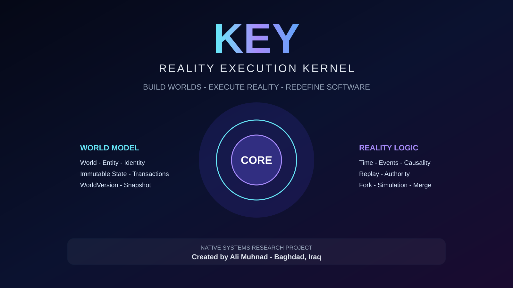

# KEY ? Native programming language

Created by **Ali Muhnad ? ??? ????**, Baghdad, Iraq.

**KEY Core 1.0.0-rc.1 for Windows x64 is available as a proprietary binary release candidate.** The compiler and command-line tools build native EXE, DLL and COFF/OBJ. Compiler implementation sources remain private.

## Download and start

[**Download KEY Core Binary 1.0.0-rc.1 ? Windows x64**](distributions/1.0.0-rc.1/KEY-Core-Binary-1.0.0-rc.1-windows-x64.zip?raw=true) ? [SHA256](distributions/1.0.0-rc.1/KEY-Core-Binary-1.0.0-rc.1-windows-x64.zip.sha256) ? [???? ????????? ????????](distributions/1.0.0-rc.1/USER_GUIDE_AR.md)

Extract the ZIP into a writable directory and open a terminal there:

```bat
key.cmd version
key.cmd test
key.cmd run examples\core1\text.key
key.cmd build examples\core1\generics.key -o example.exe
```

The package contains the compiler, native command-line tools, nine example source files (eight runnable smoke examples plus their imported module), an inventory demo, documentation, and file hashes. It runs without Python, C++, LLVM, an assembler or external linker for ordinary EXE/direct DLL builds. Foreign-host OBJ linking requires the host's linker.

## What you can use

KEY Core includes explicit type/function generics, tagged enums and exhaustive match, immutable UTF-8 Text, modules, ownership and borrows, destructors, transactional worlds, and a defined Windows foreign interface. Commands include build, run, check, test and fmt.

[Distribution overview](distributions/1.0.0-rc.1/README.md) ? [Browse examples](distributions/1.0.0-rc.1/examples) ? [Validation and limits](distributions/1.0.0-rc.1/VALIDATION.md)

## License

The [KEY Core Binary Distribution License](distributions/1.0.0-rc.1/LICENSE.md) permits free use for learning and application development, including commercial applications. You may distribute your compiled applications with the runtime code embedded by KEY, and adapt the supplied examples under the stated terms. KEY compiler/tool executables themselves cannot be redistributed or modified without additional permission. **This is not an open-source release.**

## Candidate status

**Experimental release candidate; stable production approval remains blocked.** The matching compiler passed 1,276 native cases and a measured 30-minute Core 1 campaign. The binary-only ZIP additionally passed 12 extracted-package checks, including the eight example programs, compilation, imports, formatting and inventory save/restart. Five allowlist regressions check that private source or the developer archive cannot enter the public package.

Independent release review and two historical soak investigations remain open. The binaries are unsigned. Read the detailed limits before use. No standard library, network library, GUI or package manager is bundled.

## Feedback and project direction

[Report a non-sensitive bug](https://github.com/alimuhnad/KEY/issues/new/choose), including the version, compiler SHA256, Windows version, command, small reproducer and actual diagnostic. For sensitive reports use the owner's contact below and [SECURITY.md](SECURITY.md).

The broader Reality Execution Kernel vision and its earlier roadmap are preserved in [the historical project profile](docs/history/PROJECT_PROFILE_before_Core1.md) and [ROADMAP.md](ROADMAP.md). Their milestones and check counts are separate from this Core 1 candidate's evidence.

## Creator and contact

**Ali Muhnad ? ??? ????**  
M.Sc. Electrical and Computer Engineering ? Baghdad, Iraq  
GitHub: [@alimuhnad](https://github.com/alimuhnad) ? Email: **alimuhnad72@gmail.com**

Copyright ? 2026 Ali Muhnad. All rights reserved except the permissions explicitly granted for the binary distribution and its examples.
